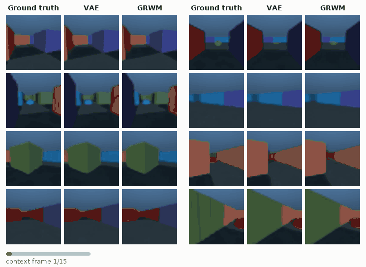
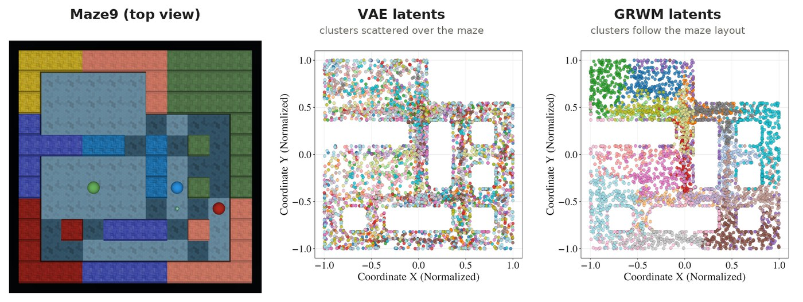
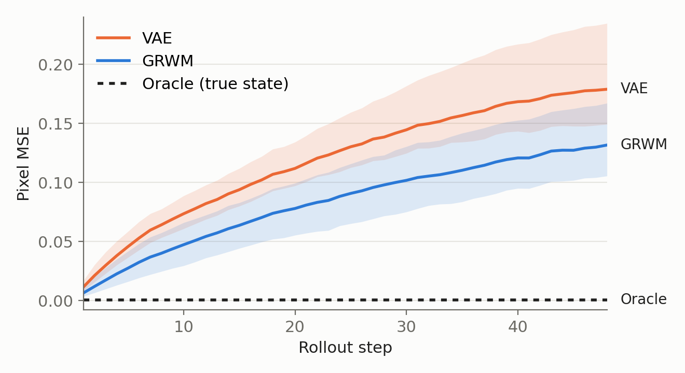
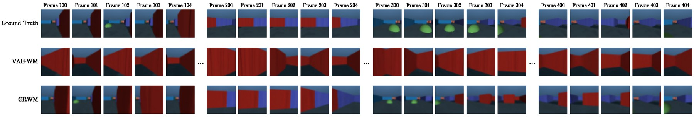
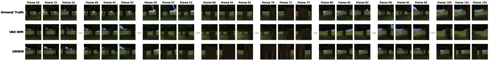

# Cloning Deterministic Worlds

Code for **Cloning Deterministic Worlds: The Critical Role of Latent Geometry in Long-Horizon World Models** (CVPR 2026) · [arXiv](https://arxiv.org/abs/2510.26782) · [Maze9 data](https://huggingface.co/datasets/xiazaishuo/cloning-deterministic-worlds-maze9) · [MC data](https://huggingface.co/datasets/xiazaishuo/cloning-deterministic-worlds-mc)

<p align="center"></p>
<p align="center"><sub>World-model rollouts on held-out Maze9 trajectories: 15 given frames, then 48 predicted steps from actions alone.</sub></p>

GRWM adds a geometric regularizer to a standard autoencoder so that its latent space follows the environment's state manifold. A world model trained in this latent space drifts less over long rollouts than the same model trained in a VAE latent space.

## Latent geometry

<p align="center"></p>

Each point is a frame drawn at the agent's true position, colored by the k-means cluster of its latent. GRWM latents of nearby positions stay together; VAE latents do not.

## Results (Maze9)

<p align="center"></p>

| | VAE | GRWM | GRWM / VAE |
|---|---|---|---|
| AE pair 1 | 0.118 | 0.062 | 0.52 |
| AE pair 2 | 0.104 | 0.087 | 0.84 |
| AE pair 3 | 0.104 | 0.077 | 0.74 |
| AE pair 4 | 0.150 | 0.107 | 0.72 |

Pixel MSE of 48-step rollouts from 15 context frames on 1000 validation windows, for 4 independently trained AE pairs (lines: mean, bands: range). The oracle rolls out the true state (x, y, heading) and stays at the renderer floor (0.00036).

## Long-horizon rollouts

<p align="center"></p>
<p align="center"></p>

Rows: ground truth, VAE world model, GRWM. Top: Maze9, frames 100–404. Bottom: Minecraft (MC-DET), frames 20–102.

## Quick start

```bash
pip install -r requirements.txt

# Maze9 from Hugging Face: 9x9_n0.8 (train) and 9x9_val (validation)
export TRAIN_DIR=/path/to/9x9_n0.8
export VAL_DIR=/path/to/9x9_val

bash run_maze9_vae_grwm.sh            # all stages
# or one stage at a time: ae | precompute | dynamics | eval
```

The script trains both autoencoders, caches their latents, trains a diffusion-forcing transformer (`configs/dit2d_maze9.yaml`) in each latent space, and evaluates the rollouts. Metrics and a per-step plot are written to `outputs/maze9_metrics/`. To inspect the latents and per-step errors, open `visualization/maze9_latent_clustering_and_mse.ipynb`.

Common settings:

| Variable | Default | |
|---|---|---|
| `AE_GPU_VAE`, `AE_GPU_GRWM` | `0`, `1` | one GPU per autoencoder |
| `PRECOMPUTE_GPUS`, `DYNAMICS_GPUS`, `PART_GPUS` | `0,...,7` | GPUs for the later stages |
| `LATENT_ROOT` | parent of `TRAIN_DIR` | where latents are cached |
| `WANDB_MODE` | `disabled` | set to `online` to log |
| `CONDA_SH`, `CONDA_ENV` | unset, `grwm` | activate an environment inside tmux jobs |

All settings are environment variables, with their defaults at the top of `run_maze9_vae_grwm.sh`.

## Minecraft (MC-DET)

Trajectories are on [Hugging Face](https://huggingface.co/datasets/xiazaishuo/cloning-deterministic-worlds-mc). Frames are rendered locally with Blender and reproduce ours bit for bit; see [`datagen/minecraft/README.md`](datagen/minecraft/README.md).

## Citation

```bibtex
@InProceedings{Xia_2026_CVPR,
    author    = {Xia, Zaishuo and Lu, Yukuan and Li, Xinyi and Xu, Yifan and Chen, Yubei},
    title     = {Cloning Deterministic Worlds: The Critical Role of Latent Geometry in Long-Horizon World Models},
    booktitle = {Proceedings of the IEEE/CVF Conference on Computer Vision and Pattern Recognition (CVPR)},
    month     = {June},
    year      = {2026},
    pages     = {32602-32612}
}
```
